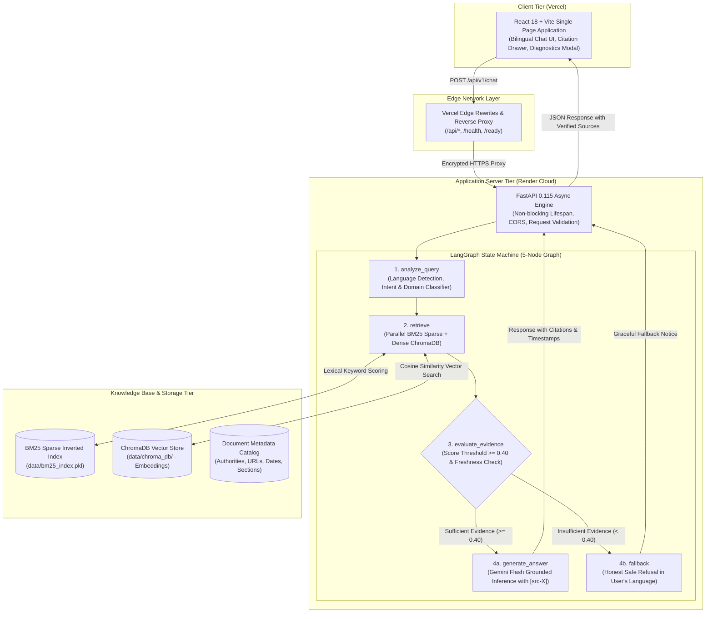
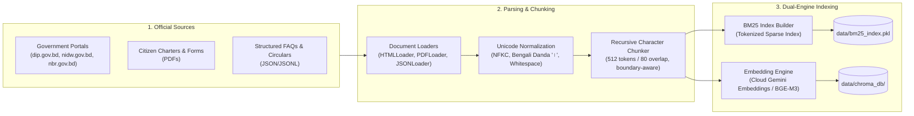
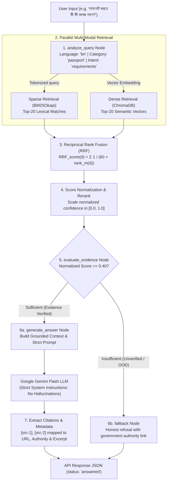

# 🏛️ Bilingual Citizen Services AI Assistant

**Ask in your language. Get understandable guidance. Check the official source.**

A production-grade, Agentic RAG-powered AI assistant for Bangladesh government public services, supporting **Bangla (বাংলা)**, **English**, and **Banglish** queries with verifiable citations from official government portals.

[](https://github.com/MehdiHossenFahim/bilingual-citizen-assistant)
[](https://python.org)
[](https://fastapi.tiangolo.com)
[](https://langchain-ai.github.io/langgraph/)
[](https://react.dev)
[](https://vitejs.dev)
[](https://github.com/MehdiHossenFahim/bilingual-citizen-assistant)

---

## ✨ Key Capabilities

| Capability | Technical Implementation |
|---|---|
| 🌐 **Bilingual Natural Language** | Native Bengali (বাংলা) & English semantic comprehension with Banglish transliteration support. |
| 📚 **Hybrid Retrieval (RAG)** | Dual-engine search: BM25 lexical keyword matching + ChromaDB dense semantic vector search. |
| ⚖️ **Reciprocal Rank Fusion (RRF)** | Rank-based fusion ($k=60$) combining sparse keyword hits and semantic dense embeddings without score calibration mismatch. |
| 🔗 **Strict Grounding & Citations** | Every administrative claim is strictly tied to an official citation `[src-X]` with portal title, authority, and official URL. |
| 🛡️ **Anti-Hallucination Safe Fallback** | Deterministic evidence thresholding ($\ge 0.40$ normalized score). Politely refuses out-of-scope or unverified queries. |
| 🔄 **LangGraph Decision Machine** | Cyclic/conditional 5-node graph: `analyze_query` → `retrieve` → `evaluate_evidence` → `generate_answer` / `fallback`. |
| ⚡ **Resilient Cloud Architecture** | Zero-RAM cloud embedding mode (`gemini-embedding-001`) with edge proxy rewrites running seamlessly within free-tier resource limits. |

**Covered Services:**
- 🛂 **Passport (ই-পাসপোর্ট / পাসপোর্ট):** Issuance fees, application requirements, renewal rules, police verification, delivery timelines (DIP).
- 🪪 **NID (জাতীয় পরিচয়পত্র):** Smart NID eligibility, voter registration, online corrections, lost card re-issuance (EC NID Wing).
- 📑 **e-TIN (করদাতা শনাক্তকারী নম্বর):** Online registration, tax zone determination, mandatory return filing criteria (NBR).

---

## 🏗️ System Architecture

The application is architected as a decoupled, cloud-ready client-server system with an Edge Reverse Proxy on Vercel and an asynchronous FastAPI + LangGraph core on Render:



---

## 🔄 How Data is Fetched & Processed

The system operates across two decoupled lifecycles: **Offline Document Ingestion** (how administrative data is acquired and indexed) and **Online Query-Time Retrieval** (how relevant passages are fetched and cited during user conversation).

### 1. Offline Document Ingestion Pipeline

Official administrative manuals, FAQs, citizen charters, and circulars are parsed into searchable multi-modal indices:



1. **Extraction (`app/ingestion/loaders.py`):** Loads content from official government endpoints and document stores.
2. **Unicode Normalization (`app/ingestion/parsing.py`):** Normalizes Bangla Unicode characters using canonical decomposition followed by canonical composition (NFKC), strips zero-width joiners/non-joiners, and normalizes Bengali numerals and danda (`।`) delimiters.
3. **Recursive Chunking (`app/ingestion/chunking.py`):** Splits text into $512$-character chunks with an $80$-character sliding overlap, prioritizing logical breaks: double newlines (`\n\n`), single newlines (`\n`), Bengali sentence danda (`।`), periods (`.`), and question marks (`?`).
4. **Dual Index Generation:**
   - **Sparse Index:** Pre-calculates BM25 term frequencies and inverted indices across all chunks, serializing to `data/bm25_index.pkl`.
   - **Dense Index:** Generates high-dimensional semantic embeddings (using zero-RAM `gemini-embedding-001` in cloud deployment or `BAAI/bge-m3` locally) and persists vectors and metadata into ChromaDB collections.

---

### 2. Online Query-Time Retrieval & Generation Pipeline

When a citizen submits a question, data is retrieved through a multi-stage fusion and evaluation pipeline:



1. **Query Analysis (`analyze_query`):** Detects user language (`bn`, `en`, or `mixed`), classifies citizen service category (Passport, NID, TIN, General), and infers administrative intent (fees, requirements, correction, tracking).
2. **Parallel Hybrid Search (`retrieve`):**
   - **Sparse BM25:** Matches exact government form numbers, fees, and terminology (e.g., "SRO 219", "Form-1", "ফি").
   - **Dense ChromaDB:** Captures conversational meaning, paraphrases, and conceptual questions (e.g., "how old do I need to be for NID?").
3. **Reciprocal Rank Fusion (RRF):**
   Merges both rank lists into a single balanced ranking using:
   $$\text{RRF}(d) = \sum_{m \in \{\text{BM25}, \text{Dense}\}} \frac{1}{k + \text{rank}_m(d)} \quad (k=60)$$
4. **Evidence Evaluation Gate (`evaluate_evidence`):**
   Computes normalized confidence scores. If the best passage falls below the calibrated `EVIDENCE_THRESHOLD` ($0.40$), the pipeline deterministically skips generation and routes to `fallback`, preventing administrative misinformation.
5. **Grounded Generation & Citation Linking (`generate_answer`):**
   Passes only retrieved official passages to the model. The model must ground every fact using inline bracket citations `[src-X]`. Citations are cross-referenced with catalog metadata (title, issuing authority, and official URL) in the API response.

---

## 🚀 Quick Start Guide

### Prerequisites

- **Python 3.11+**
- **Node.js 18+** & npm
- A [Google Gemini API Key](https://aistudio.google.com/app/apikey)

### 1. Clone the Repository

```bash
git clone https://github.com/MehdiHossenFahim/bilingual-citizen-assistant.git
cd bilingual-citizen-assistant
```

### 2. Configure Environment

Create your environment configuration:

```bash
cp .env.example .env
```

Open `.env` and insert your Gemini API Key:
```ini
GEMINI_API_KEY=your_gemini_api_key_here
GENERATION_MODEL=gemini-2.5-flash
EMBEDDING_MODEL=gemini-embedding-001
RERANKER_MODEL=none
EVIDENCE_THRESHOLD=0.40
```

### 3. Backend Setup

```bash
# Create and activate virtual environment
python -m venv .venv

# Windows:
.venv\Scripts\activate
# Linux/macOS:
source .venv/bin/activate

# Install Python dependencies
pip install -r requirements.txt

# Ingest and build knowledge base indices
python scripts/ingest.py

# Start the FastAPI server
python -m uvicorn app.main:app --host 0.0.0.0 --port 8000 --reload
```

* API Health Check: `http://localhost:8000/health`
* Interactive API Documentation: `http://localhost:8000/docs`

### 4. Frontend Setup

In a new terminal:

```bash
cd frontend
npm install
npm run dev
```

Open your browser at `http://localhost:5173`.

---

## 🐳 Docker Deployment

The complete application is containerized with Docker Compose:

```bash
# Ensure .env contains your GEMINI_API_KEY
docker compose up --build
```

- **Web Frontend:** `http://localhost:8501`
- **Backend API:** `http://localhost:8000`
- **Interactive Swagger Docs:** `http://localhost:8000/docs`

---

## 📡 API Reference

### `POST /api/v1/chat`

Submit a natural language citizen service query in Bangla or English.

#### Request

```bash
curl -X POST https://bilingual-citizen-assistant.onrender.com/api/v1/chat \
  -H "Content-Type: application/json" \
  -d '{
    "query": "পাসপোর্ট করতে কী কী কাগজ লাগে?",
    "language": "auto"
  }'
```

#### Response (`200 OK`)

```json
{
  "answer": "ই-পাসপোর্ট আবেদনের জন্য নিম্নলিখিত কাগজপত্র প্রয়োজন:\n1. অনলাইন আবেদনপত্রের সারসংক্ষেপ (Application Summary) ও পেমেন্ট স্লট...\n2. জাতীয় পরিচয়পত্র (NID) অথবা ২০ বছরের নিচে হলে অনলাইন জন্ম নিবন্ধন সনদ [src-1]...",
  "language": "bn",
  "status": "answered",
  "citations": [
    {
      "source_id": "8d7abd7781e30ccc43ae",
      "title": "Passport FAQ — Frequently Asked Questions",
      "authority": "Department of Immigration and Passports (DIP)",
      "url": "https://www.dip.gov.bd/site/page/faq/",
      "page": null,
      "excerpt": "Citizens under 20 years may use a Birth Registration Certificate instead of an NID..."
    }
  ],
  "limitations": [
    "Multiple source dates found; older documents may contain superseded information."
  ],
  "session_id": "sess_89f3a1",
  "latency_ms": 1420.5
}
```

---

## 🧪 Automated Testing & Evaluation

The repository includes a comprehensive unit, integration, and quantitative evaluation suite:

```bash
# Run all automated test suites
pytest tests/ -v

# Run targeted test suites
pytest tests/test_api.py -v        # Endpoint validation & CORS checks
pytest tests/test_retrieval.py -v  # Sparse BM25 + Dense RRF integration
pytest tests/test_citations.py -v  # Strict citation extraction logic
pytest tests/test_fallback.py -v   # Out-of-domain safe fallback gates
```

### Benchmark Evaluation Suite

```bash
python -m app.evaluation.evaluator
```
Evaluates the assistant across 40+ audited test cases covering:
- **In-domain factual questions:** Passport fees, NID renewal, e-TIN requirements.
- **Cross-lingual queries:** Identical questions phrased in formal Bangla, colloquial Bangla, English, and Banglish.
- **Adversarial / Out-of-Domain questions:** Stock trading, medical advice, visa lottery rumors — verifying zero unsupported hallucinations.

---

## 📁 Repository Structure

```
bilingual-citizen-assistant/
├── app/
│   ├── api/
│   │   ├── routes/
│   │   │   ├── chat.py             # POST /api/v1/chat (Core RAG route)
│   │   │   ├── sources.py          # GET /api/v1/sources/{id}
│   │   │   └── feedback.py         # POST /api/v1/feedback
│   │   └── schemas.py              # Pydantic request/response schemas
│   ├── ingestion/
│   │   ├── loaders.py              # Web HTML / PDF / JSON document loaders
│   │   ├── parsing.py              # NFKC normalization & language detection
│   │   └── chunking.py             # Recursive chunking with Bangla danda support
│   ├── retrieval/
│   │   ├── bm25.py                 # BM25Okapi inverted index & persistence
│   │   ├── dense_search.py         # ChromaDB client & embedding wrappers
│   │   ├── fusion.py               # Reciprocal Rank Fusion (RRF)
│   │   └── reranker.py             # Cross-encoder reranker
│   ├── graph/
│   │   ├── state.py                # LangGraph TypedDict state schema
│   │   ├── nodes.py                # LangGraph node functions
│   │   └── workflow.py             # Compiled StateGraph workflow definition
│   ├── generation/
│   │   ├── generator.py            # Gemini API grounded answer generator
│   │   └── prompts.py              # System instructions & citation guidelines
│   ├── evaluation/
│   │   ├── dataset.py              # 40+ curated test questions
│   │   └── evaluator.py            # Evaluation benchmark runner
│   ├── config.py                   # Pydantic BaseSettings configuration
│   └── main.py                     # FastAPI application & non-blocking lifespan
├── frontend/
│   ├── src/
│   │   ├── components/             # Header, Sidebar, CitationCard, DiagnosticsModal
│   │   ├── App.jsx                 # Main React chat workspace & status sync
│   │   ├── main.jsx                # React DOM entrypoint
│   │   └── index.css               # Clean responsive styling & animations
│   ├── package.json                # Frontend dependencies
│   ├── vite.config.js              # Vite server & proxy configuration
│   └── vercel.json                 # Frontend-scoped Vercel rewrites
├── data/
│   ├── sources/
│   │   └── sample_data.json        # Curated public services knowledge base
│   └── README.md
├── tests/
│   ├── test_api.py                 # API endpoint tests
│   ├── test_retrieval.py           # Retrieval & fusion tests
│   ├── test_citations.py           # Citation parsing tests
│   └── test_fallback.py            # Anti-hallucination fallback tests
├── scripts/
│   └── ingest.py                   # Ingestion CLI script
├── docs/
│   ├── architecture.md             # System architecture & component documentation
│   └── api.md                      # Complete API documentation
├── Dockerfile                      # Multi-stage production container
├── compose.yaml                    # Docker Compose configuration
├── requirements.txt                # Production Python dependencies
├── package.json                    # Root package descriptor for monorepo CI/CD
├── vercel.json                     # Root reverse proxy & build specification
├── render.yaml                     # Render Cloud deployment blueprint
├── .env.example                    # Sample environment template
└── README.md                       # Master project documentation
```

---

## ⚙️ Configuration Parameters

All system configurations can be set via `.env`:

| Parameter | Default | Production (Render) | Purpose |
|---|---|---|---|
| `GEMINI_API_KEY` | *required* | *configured* | Google AI Studio API access key |
| `GENERATION_MODEL` | `gemini-2.5-flash` | `gemini-2.5-flash` | LLM model for grounded answer generation |
| `EMBEDDING_MODEL` | `BAAI/bge-m3` | `gemini-embedding-001` | Semantic embeddings (`gemini-embedding-001` uses 0 MB local RAM) |
| `RERANKER_MODEL` | `BAAI/bge-reranker-v2-m3` | `none` (RRF mode) | Cross-encoder model (`none` enables fast zero-RAM RRF scoring) |
| `EVIDENCE_THRESHOLD` | `0.40` | `0.40` | Minimum normalized confidence score required to answer |
| `CHROMA_PERSIST_DIR` | `./data/chroma_db` | `./data/chroma_db` | Persistent vector store path |
| `BM25_INDEX_PATH` | `./data/bm25_index.pkl` | `./data/bm25_index.pkl` | Serialized sparse index file path |
| `BM25_TOP_K` | `20` | `20` | Candidate chunk count for sparse search |
| `DENSE_TOP_K` | `20` | `20` | Candidate chunk count for dense vector search |
| `RERANKER_TOP_K` | `5` | `5` | Maximum number of context passages passed to LLM |

---

## ⚠️ Important Disclaimers

1. **Non-Governmental System:** This application is an educational AI research project and does **not** officially represent any department of the Government of the People's Republic of Bangladesh.
2. **Advisory Nature:** Information provided is for citizen guidance only. Official decisions, fee payments, and formal submissions must always be conducted through official government portals.
3. **Statutory Fee Changes:** Government service fees, SRO rules, and policies change periodically. Always verify current fees with the issuing authority.

---

## 👨‍💻 Author & Project Details

- **Author / Developer:** Mehedi Hossen Fahim
- **GitHub Profile:** [@MehdiHossenFahim](https://github.com/MehdiHossenFahim)
- **Repository:** [https://github.com/MehdiHossenFahim/bilingual-citizen-assistant](https://github.com/MehdiHossenFahim/bilingual-citizen-assistant)
- **Project Domain:** Agentic RAG · Multilingual Information Retrieval · Citizen Services
- **Academic Submission:** AI Capstone Project Submission

---

## 📜 License

Distributed under the MIT License for educational and public-benefit demonstration purposes.
