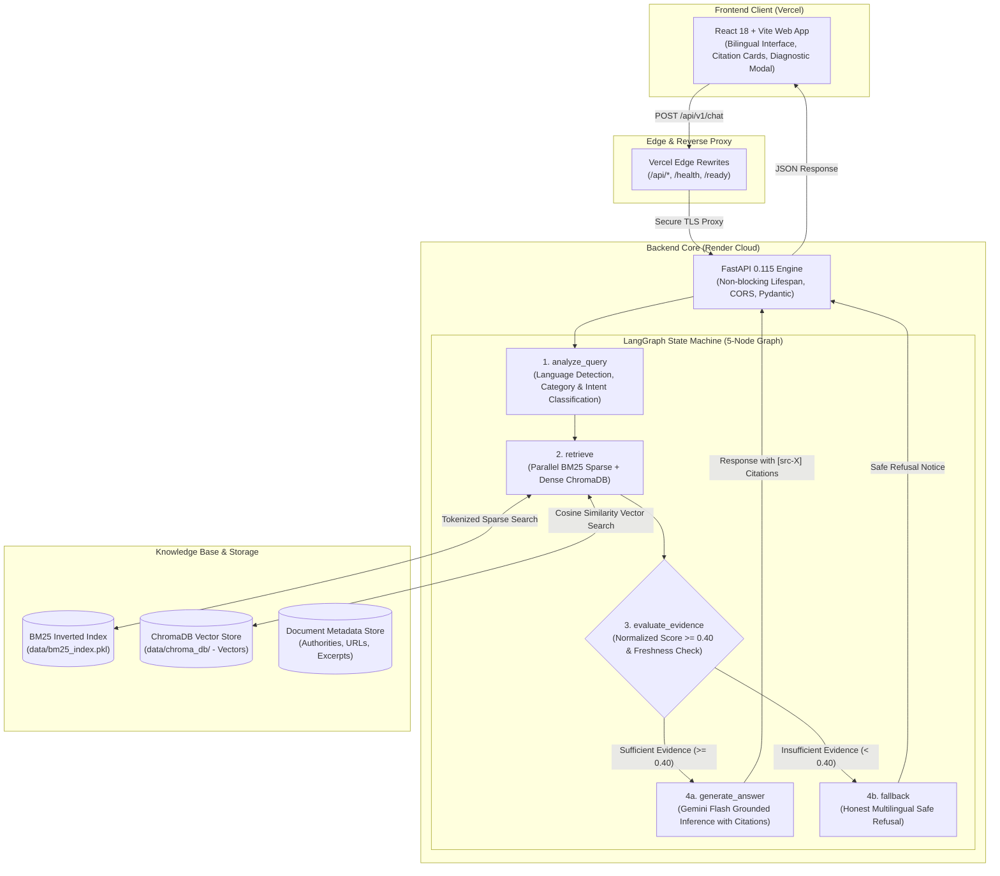
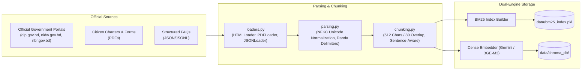
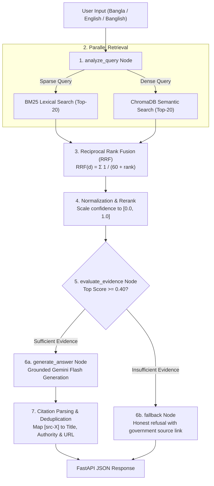

# Architecture — Bilingual Citizen Services AI Assistant

**Author / Developer:** Mehedi Hossen Fahim  
**Repository:** [https://github.com/MehdiHossenFahim/bilingual-citizen-assistant](https://github.com/MehdiHossenFahim/bilingual-citizen-assistant)

---

## 1. System Overview

The Bilingual Citizen Services AI Assistant is a decoupled, modern cloud-native system designed for high reliability, zero hallucinations, and low latency across Bengali (বাংলা) and English queries.

---

## 2. Component Detail

### 1. Ingestion Pipeline

Official administrative manuals, FAQs, citizen charters, and circulars are pre-processed into dual-engine indices:

1. **Loaders (`app/ingestion/loaders.py`):** Ingests raw content from structured JSON files, live government URLs, and downloadable PDF circulars.
2. **Parsing (`app/ingestion/parsing.py`):** Applies Unicode NFKC normalization, strips non-printable control characters, and standardizes Bengali punctuation (such as the sentence-ending danda `।`).
3. **Chunking (`app/ingestion/chunking.py`):** Uses recursive splitting respecting linguistic sentence boundaries with 512 characters and 80-character overlap.
4. **Dual Indexing:**
   - **Sparse Index:** Precomputes BM25Okapi inverted term frequencies serialized to `data/bm25_index.pkl`.
   - **Dense Index:** Generates high-dimensional semantic embeddings (using zero-RAM `gemini-embedding-001` in production or `BAAI/bge-m3` locally) saved to ChromaDB.

---

### 2. Query-Time Execution Pipeline

| Step | Component | Responsibilities |
|---|---|---|
| 1 | `analyze_query` | Detects language (`bn`, `en`, `mixed`), identifies domain (Passport, NID, e-TIN), and classifies intent. |
| 2 | `bm25.retrieve()` | BM25Okapi scores top-20 chunks based on exact term matches. |
| 3 | `dense_search.retrieve()` | Vector search queries top-20 nearest semantic neighbors via cosine similarity. |
| 4 | `fusion.rrf()` | Merges both candidate lists using Reciprocal Rank Fusion ($k=60$). |
| 5 | `reranker.rerank()` | Normalizes candidate scores to $[0.0, 1.0]$. |
| 6 | `evaluate_evidence` | Evaluates evidence sufficiency against threshold ($0.40$), checks currency, and detects conflicting source dates. |
| 7a | `generate_answer` | Generates grounded answer using Google Gemini Flash, inserting verifiable citations. |
| 7b | `fallback` | Returns honest, courteous failure response in the user's language without hallucination. |

---

### 3. Why Hybrid Retrieval (BM25 + Dense)?

| Query Characteristic | BM25 Sparse | Dense Semantic | Hybrid RRF Benefit |
|---|---|---|---|
| **Exact form numbers** ("Form-1", "SRO 219") | High Precision | Low Precision | Catches exact administrative codes |
| **Official acronyms** ("NID", "TIN", "DIP", "MRP") | Direct Token Match | Semantic Embedding | Guarantees exact government acronym matching |
| **Colloquial questions** ("পাসপোর্ট বানাতে কী লাগবে?") | Partial Match | High Recall | Understands semantic intent regardless of phrasing |
| **Cross-lingual queries** ("how to apply for Smart NID") | English only | Cross-lingual embedding | Bridges English queries with Bengali regulations |
| **Morphological variations** ("নবায়ন", "রিনিউ", "renew") | Stemming dependent | Semantic association | Handles informal synonyms cleanly |

---

### 4. Technology Stack & Specifications

| Tier | Component | Technology | Role |
|---|---|---|---|
| **Frontend** | User Interface | React 18.3 + Vite 5.4 | Single Page Application with citation cards & health diagnostics |
| **Hosting (Client)** | Web Hosting & Proxy | Vercel | Edge routing, asset CDN, and serverless reverse proxy |
| **Backend** | API Engine | FastAPI 0.115 + Uvicorn | Asynchronous request processing, CORS, and OpenAPI docs |
| **Hosting (Server)** | Application Server | Render (Linux Container) | Dockerized backend with non-blocking lifecycle management |
| **Orchestrator** | RAG State Machine | LangGraph 0.2 | Deterministic conditional workflow state machine |
| **Sparse Engine** | Lexical Index | `rank-bm25` (BM25Okapi) | Inverted keyword index with Bengali tokenization |
| **Dense Engine** | Vector Database | ChromaDB 0.5+ | Persistent local vector store |
| **Embeddings** | Semantic Vectors | Gemini Cloud Embeddings / BGE-M3 | Zero-RAM cloud embeddings (`gemini-embedding-001`) |
| **Generative LLM** | Answer Generator | Google Gemini Flash | Grounded inference with strict citation extraction |
| **Evaluation** | Quality Benchmark | Custom bilingual evaluation suite | 40+ audited test cases across accuracy, citations, and fallback |
